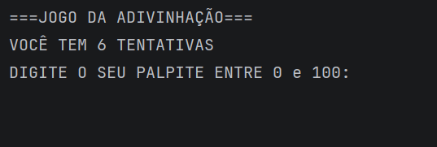
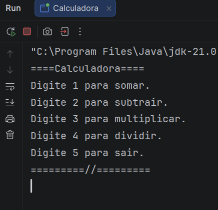

## Como executar

```bash
git clone https://github.com/jpnascimentof/calculator-and-guess-game.git
cd calculator-and-guess-game
mvn compile
```

Cada programa roda de forma independente:

```bash
# Calculadora
mvn exec:java -Dexec.mainClass="basico.Calculadora"

# Jogo de adivinhação
mvn exec:java -Dexec.mainClass="basico.JogoAdivinhacao"
```

Ou abra o projeto na sua IDE de preferência e execute a classe desejada ( botão ▶ )

## Estrutura

```
src/main/java/basico/
├── Calculadora.java
└── JogoAdivinhacao.java
```
## Prints

### Menu do jogo


### Menu da calculadora

